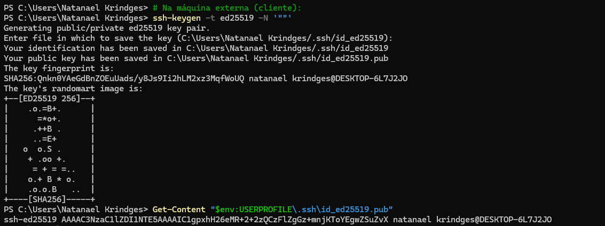
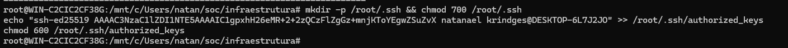
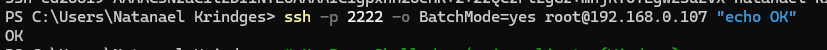
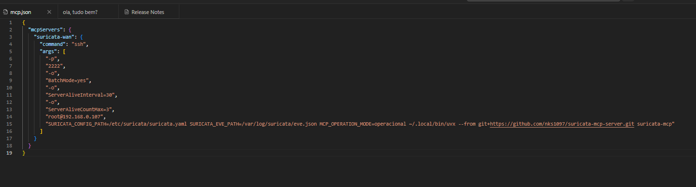

# Suricata MCP Server 🛡️🚀

[](https://github.com/nks1097/suricata-mcp-server/actions)
[](https://opensource.org/licenses/MIT)
[](https://www.python.org/downloads/)
[](https://modelcontextprotocol.io/)
[](https://suricata.io/)

Servidor **Model Context Protocol (MCP)** para **Suricata IDS/IPS, Network Security Monitoring (NSM)** e segurança defensiva de rede. Fornece **100 ferramentas em português**, prontas para produção internacional e projetadas para permitir que agentes de Inteligência Artificial analisem tráfego, investiguem incidentes, gerenciem regras de detecção e auditem sensores.

> **[Read English Documentation (README.en.md)](README.en.md)**

---

## 🌟 Principais Recursos

* **100 Ferramentas MCP Especializadas em Português:** Divididas em 10 categorias essenciais cobrindo ponta a ponta desde diagnósticos de sensores até relatórios executivos.
* **Leitor Incremental de EVE JSON de Alta Performance:** Suporta arquivos `eve.json` de dezenas de gigabytes sem estourar memória RAM, utilizando seek reverso em blocos e streaming.
* **Análise Forense de PCAP Isolada:** Ingestão offline de capturas `.pcap` e `.pcapng` com validação de magic bytes e limites de segurança.
* **Gerenciamento Controlado de Regras:** AST parser de regras Suricata, validação estrita de sintaxe, preview de diff unificado e backups automáticos `.bak`.
* **Segurança e Menor Privilégio (RBAC):** Perfis de acesso `somente_leitura`, `operacional` e `administrativo`.
* **Proteção contra Injeção e Path Traversal:** Comandos executados exclusivamente via `subprocess` com argumentos em lista, sem shell e com whitelisting estrito de binários.
* **Redação Automática de Segredos:** Mascaramento inteligente de senhas, chaves de API e tokens sensíveis.
* **Geração Profissional de Relatórios:** Exportação nativa em **PDF** estilizado (ReportLab), planilhas **XLSX** multi-abas (OpenPyXL), **CSV** e **JSON**.
* **Trilhas de Auditoria Estruturada:** Registro de todas as chamadas em JSON Lines com identificador único de requisição e telemetria de duração.
* **Transportes STDIO e SSE:** Compatível nativamente com Claude Desktop, Cursor, Antigravity IDE, Ollama e clientes remotos.

---

## 📐 Arquitetura

```
+-------------------------------------------------------------+
|                Agente de IA / Cliente MCP                   |
|       (Claude Desktop, Cursor, Antigravity IDE, etc.)       |
+-------------------------------------------------------------+
                              |
                     [ STDIO / SSE Transport ]
                              v
+-------------------------------------------------------------+
|                     Suricata MCP Server                     |
|                                                             |
|  +-------------------------------------------------------+  |
|  |           Camada de Autorização & RBAC                |  |
|  |  (somente_leitura | operacional | administrativo)     |  |
|  +-------------------------------------------------------+  |
|                             |                               |
|  +-------------------------------------------------------+  |
|  |           Trilha de Auditoria & Redação Segredos      |  |
|  +-------------------------------------------------------+  |
|                             |                               |
|  +-------------------------------------------------------+  |
|  |                 100 Ferramentas MCP                   |  |
|  +-------------------------------------------------------+  |
+-------------------------------------------------------------+
          |                   |                     |
          v                   v                     v
+------------------+ +------------------+ +-------------------+
|  EVE JSON Engine | | Subprocess Runner| | Unix Socket Client|
+------------------+ +------------------+ +-------------------+
```

---

## 🧰 As 100 Ferramentas MCP (Visão Geral por Categoria)

| Categoria | Faixa | Foco Operacional |
| :--- | :---: | :--- |
| **A. Sensores e Estado Operacional** | 01–10 | Conectividade, versão, integridade, diagnósticos e interfaces. |
| **B. Eventos EVE e Telemetria** | 11–20 | Pesquisa em `eve.json`, alertas, fluxos, DNS, HTTP, TLS, SSH, arquivos. |
| **C. Análise de Rede e Conexões** | 21–30 | Investigação de IP, 5-tuple, Top Talkers, varreduras e DGAs. |
| **D. Alertas e Detecção** | 31–40 | Correlação de alertas, SIDs, picos, classificação de incidentes e falsos positivos. |
| **E. Regras e Assinaturas** | 41–50 | Consulta, validação, diff, adição local, suricata-update e hot reload. |
| **F. PCAP e Análise Forense** | 51–60 | Validação de capturas, execução offline, extração de alertas e fluxos. |
| **G. Estatísticas e Desempenho** | 61–70 | Taxas de descarte (drops), threads, buffers, contadores e capacidade. |
| **H. Configuração e Gestão** | 71–80 | Validação de `suricata.yaml`, rotação de logs e auditoria de arquivos. |
| **I. Resposta Defensiva e SIEM** | 81–90 | Planos de resposta, gestão de incidentes, IoCs e pacotes de evidências. |
| **J. Relatórios e Automação** | 91–100 | Relatórios executivos em PDF/XLSX/CSV/JSON e auditoria MCP. |

Consulte o catálogo completo em [docs/ferramentas.md](docs/ferramentas.md).

---

## 🚀 Instalação Rápida e Universal

### Passo 0: Ter o `uv` instalado (Se ainda não tiver)

O `uv` é o gerenciador de pacotes ultrarrápido recomendado. Se ainda não possui:

* **Windows (PowerShell):**
  ```powershell
  powershell -ExecutionPolicy ByPass -c "irm https://astral.sh/uv/install.ps1 | iex"
  # ATENÇÃO: Recarregue o PATH da sua janela atual:
  $env:Path = "$HOME\.local\bin;$env:Path"
  ```
* **Linux / macOS:**
  ```bash
  curl -LsSf https://astral.sh/uv/install.sh | sh
  source $HOME/.local/bin/env
  ```

> ⚠️ **Atenção Windows:** Se após instalar o `uv` você receber o erro `O termo 'uvx' não é reconhecido`:
> 1. Execute `$env:Path = "$HOME\.local\bin;$env:Path"` no PowerShell atual; **OU**
> 2. Feche e abra uma nova janela do terminal; **OU**
> 3. Chame diretamente com o caminho completo: `& "$HOME\.local\bin\uvx.exe" ...`

---

### Opção 1: Zero-Install com `uvx` (Recomendado)
Não é necessário clonar nem instalar nada manualmente. O comando `uvx` executa o servidor diretamente do GitHub:

```bash
# Diagnóstico automático do seu ambiente Suricata
uvx --from git+https://github.com/nks1097/suricata-mcp-server.git suricata-mcp --doctor
```
### VIDEO DE CONFIGURAÇÃO DE FORMA SIMPLIFICADA

 ▶️ **[Clique aqui para assistir ao vídeo completo no Google Drive Assiste em Full Hd (1080P)](https://drive.google.com/file/d/1TfmgfF_5ZUVM2LLYEZjAnSn6_PJfFsjF/view?usp=drive_link)**
---

### Opção 2: Instalação direta com `pip` (Sem precisar de uv)
```bash
# Instala diretamente do repositório oficial
pip install git+https://github.com/nks1097/suricata-mcp-server.git

# Executa o diagnóstico automático (funciona sempre via Python, sem erro de PATH no Windows):
python -m suricata_mcp --doctor
```

---

### Opção 3: Clonando o repositório (Para desenvolvedores)
```bash
# 1. Clone o repositório
git clone https://github.com/nks1097/suricata-mcp-server.git
cd suricata-mcp-server

# 2. Crie e ative o ambiente virtual
python -m venv .venv
# No Linux/macOS: source .venv/bin/activate
# No Windows:     .\.venv\Scripts\Activate.ps1

# 3. Instale em modo editável
pip install -e .

# 4. Execute o diagnóstico automático
python -m suricata_mcp --doctor
```

---

## ⚙️ Configuração nos Clientes MCP

### 1. Claude Desktop (`claude_desktop_config.json`)

#### Linux / macOS:
```json
{
  "mcpServers": {
    "suricata": {
      "command": "uvx",
      "args": [
        "--from",
        "git+https://github.com/nks1097/suricata-mcp-server.git",
        "suricata-mcp"
      ],
      "env": {
        "SURICATA_CONFIG_PATH": "/etc/suricata/suricata.yaml",
        "SURICATA_EVE_PATH": "/var/log/suricata/eve.json",
        "MCP_OPERATION_MODE": "operacional"
      }
    }
  }
}
```

#### Windows:
```json
{
  "mcpServers": {
    "suricata": {
      "command": "uvx",
      "args": [
        "--from",
        "git+https://github.com/nks1097/suricata-mcp-server.git",
        "suricata-mcp"
      ],
      "env": {
        "SURICATA_CONFIG_PATH": "C:/Program Files/Suricata/suricata.yaml",
        "SURICATA_EVE_PATH": "C:/Program Files/Suricata/log/eve.json",
        "MCP_OPERATION_MODE": "operacional"
      }
    }
  }
}
```

> 💡 **Dica Windows para Claude Desktop:** Se o Claude exibir erro informando que não encontrou o comando `uvx`, defina o caminho absoluto do binário:
> `"command": "C:\\Users\\SEU_USUARIO\\.local\\bin\\uvx.exe"` (substituindo `SEU_USUARIO` pelo seu usuário do Windows) ou use `"command": "python"`, `"args": ["-m", "suricata_mcp.server", "--transport", "stdio"]` se tiver instalado via `pip`.

---

### 2. Cursor IDE (`.cursor/mcp.json`)
```json
{
  "mcpServers": {
    "suricata": {
      "command": "uvx",
      "args": [
        "--from",
        "git+https://github.com/nks1097/suricata-mcp-server.git",
        "suricata-mcp"
      ]
    }
  }
}
```

---

### 3. Execução em Servidor via Docker (Produção SOC / SIEM)
```json
{
  "mcpServers": {
    "suricata": {
      "command": "docker",
      "args": [
        "run", "-i", "--rm",
        "-v", "/var/log/suricata:/var/log/suricata:ro",
        "-v", "/etc/suricata:/etc/suricata:ro",
        "-e", "SURICATA_EVE_PATH=/var/log/suricata/eve.json",
        "ghcr.io/nks1097/suricata-mcp-server:latest"
      ]
    }
  }
}
```

---

### 4. Acesso Remoto Seguro via SSH (WAN / LAN / WSL / Cloud)

Ideal para conectar ferramentas de IA (como **LM Studio**, **Claude Desktop** ou **Cursor**) a sensores Suricata remotos rodando em servidores dedicados, instâncias em nuvem, Raspberry Pi ou WSL, utilizando SSH como túnel seguro e criptografado:

#### Passo 1: Configurar Chave SSH no Cliente (Sem Senha)
Gere um par de chaves no computador cliente (onde está o LM Studio/Claude Desktop) e autorize no servidor remoto:

```powershell
# No PowerShell da máquina cliente (Windows):
ssh-keygen -t ed25519 -N '""'
Get-Content "$env:USERPROFILE\.ssh\id_ed25519.pub"
```
* Exemplo 1 Configurar Chave SSH no Cliente (Sem Senha)


*(No Linux ou macOS cliente, use `ssh-keygen -t ed25519 -N ""` e `cat ~/.ssh/id_ed25519.pub`)*.

Copie a chave exibida (iniciando em `ssh-ed25519 AAAAC3...`).

No servidor remoto (onde o Suricata e o `uv` estão instalados):
```bash
mkdir -p ~/.ssh && chmod 700 ~/.ssh
echo "COLE_AQUI_A_CHAVE_COPIADA" >> ~/.ssh/authorized_keys
chmod 600 ~/.ssh/authorized_keys
```
* Exemplo 2 Copie a chave exibida


Valide o acesso sem senha a partir do cliente:
```powershell
ssh -p SUA_PORTA_SSH -o BatchMode=yes USEU_USUARIO@IP_DO_SERVIDOR "echo OK"
```
* Exemplo 3 Valide o acesso sem senha a partir do cliente


*(Retornando `OK`, a autenticação está pronta).*

* Exemplo 4 (Retornando `OK`, a autenticação está pronta)

---

#### Passo 2: Configuração no `mcp.json`

##### Exemplo para Rede Local / WSL:
```json
{
  "mcpServers": {
    "suricata-remoto": {
      "command": "ssh",
      "args": [
        "-p",
        "<PORTA_EXTERNA>",
        "-o",
        "BatchMode=yes",
        "-o",
        "ServerAliveInterval=30",
        "-o",
        "ServerAliveCountMax=3",
        "<USUARIO>@<IP_PUBLICO_OU_DDNS>",
        "SURICATA_CONFIG_PATH=/etc/suricata/suricata.yaml SURICATA_EVE_PATH=/var/log/suricata/eve.json MCP_OPERATION_MODE=operacional ~/.local/bin/uvx --from git+https://github.com/nks1097/suricata-mcp-server.git suricata-mcp"
      ]
    }
  }
}
```

##### Exemplo para Internet Externa (WAN / DDNS / Cloud):
```json
{
  "mcpServers": {
    "suricata-wan": {
      "command": "ssh",
      "args": [
        "-p",
        "<PORTA_EXTERNA>",
        "-o",
        "BatchMode=yes",
        "-o",
        "ServerAliveInterval=30",
        "-o",
        "ServerAliveCountMax=3",
        "<USUARIO>@<IP_PUBLICO_OU_DDNS>",
        "SURICATA_CONFIG_PATH=/etc/suricata/suricata.yaml SURICATA_EVE_PATH=/var/log/suricata/eve.json MCP_OPERATION_MODE=operacional ~/.local/bin/uvx --from git+https://github.com/nks1097/suricata-mcp-server.git suricata-mcp"
      ]
    }
  }
}
```
* Exemplo 5 para Internet Externa (WAN / DDNS / Cloud)


### VIDEO DE CONFIGURAÇÃO DE FORMA SIMPLIFICADA PARA CONFIGURAR O SSH DO MCP DE UM SERVIDOR EXTERNO

 ▶️ **[Clique aqui para assistir ao vídeo completo no Google Drive Assiste em Full Hd (1080P)](https://drive.google.com/file/d/1lm1zdztMoavf4EO4UpUvI2wyehSaStHf/view?usp=drive_link)**

> 🛡️ **Parâmetros de Estabilidade de Conexão:**
> * `BatchMode=yes`: Impede travamento por prompts interativos de senha caso a chave falhe.
> * `ServerAliveInterval=30` e `ServerAliveCountMax=3`: Envia pacotes *keep-alive* a cada 30 segundos, impedindo que firewalls corporativos, roteadores ou tabelas de NAT encerrem silenciosamente conexões SSH ociosas.
```

---

## 🩺 Diagnóstico com `suricata-mcp --doctor`

Para verificar se o Suricata está corretamente configurado no seu sistema e validar arquivos de log, execute:

```bash
suricata-mcp --doctor
```

O comando inspeciona os caminhos, mede o tamanho do `eve.json`, checa as regras locais e exibe a configuração JSON personalizada para a sua máquina.

---

## 🧪 Testes e Qualidade

O projeto conta com suite completa de testes automatizados:

```bash
# Executar todos os testes unitários (127 testes)
pytest -v

# Validação de linting com Ruff
ruff check .

# Validação de tipagem estática estrita
mypy src
```

---

## 📄 Licença

Distribuído sob a licença **MIT**. Veja [LICENSE](LICENSE) para mais detalhes.

**Autor:** Natanael Krindges (<natanael1097@gmail.com>)

